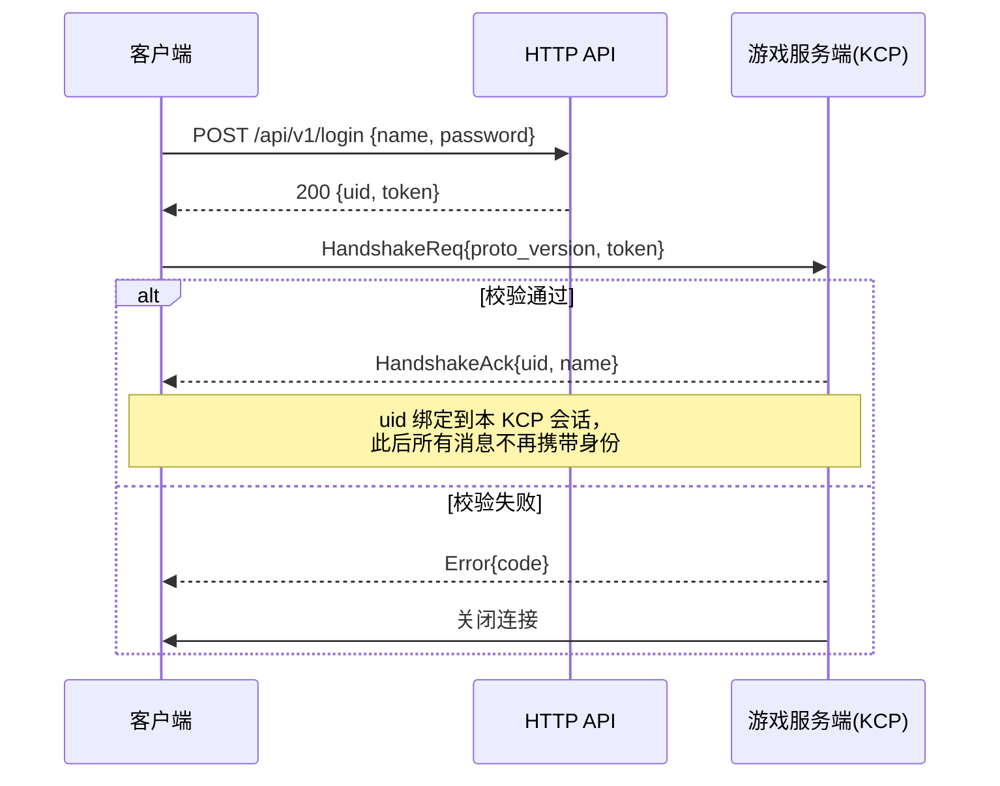
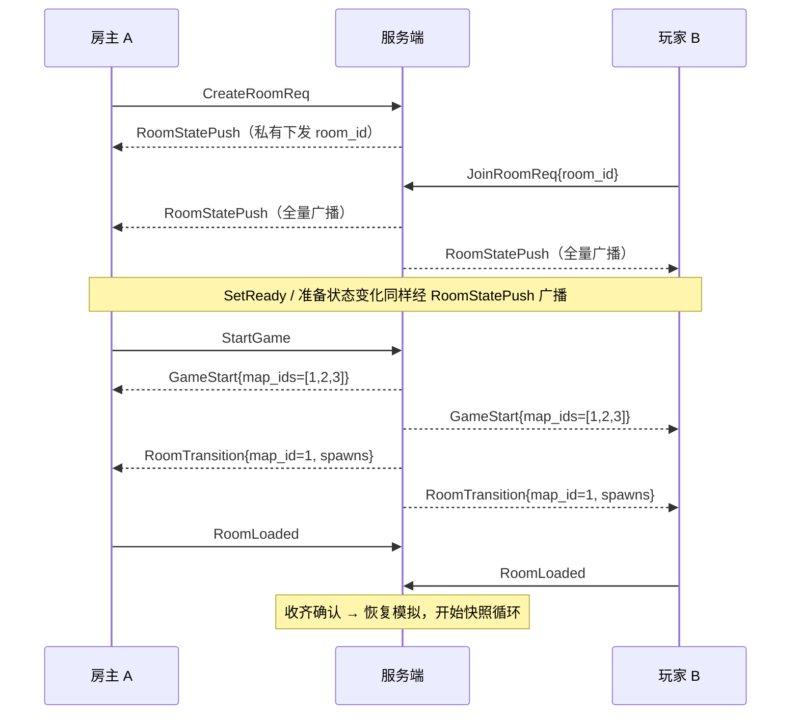
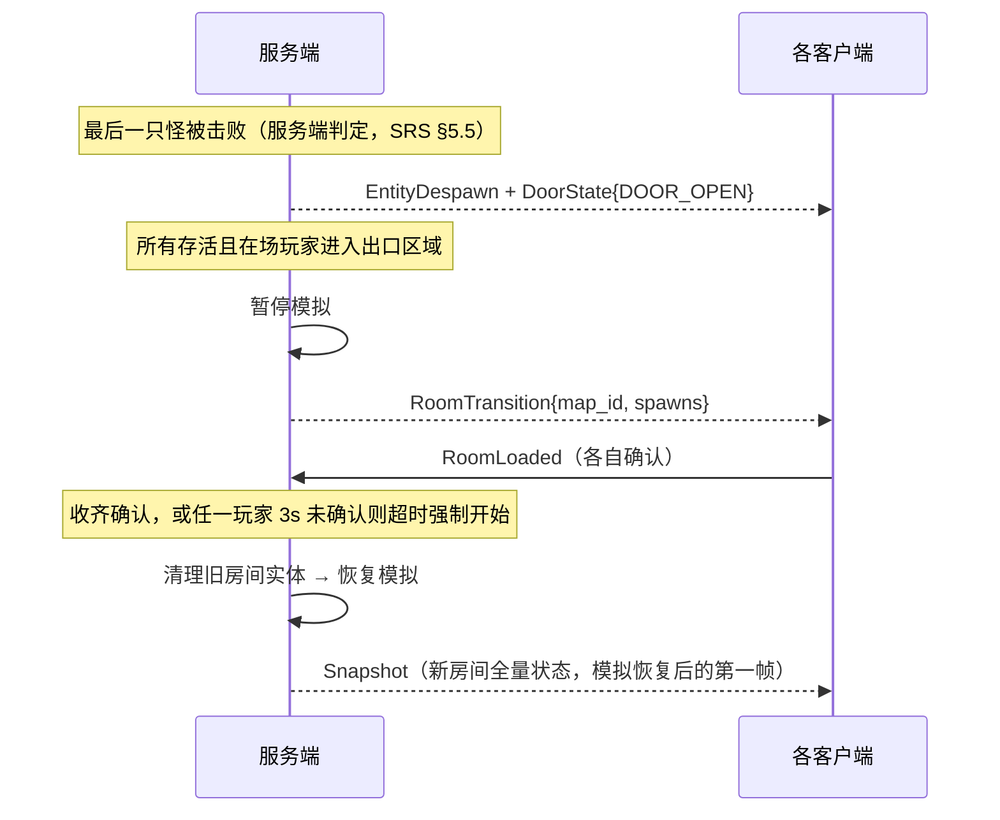

# Knight 网络协议规范

**文档版本：** V0.1（草案，待评审）
**上游需求：** [SRS-需求规格说明书.md](./SRS-需求规格说明书.md) §3 / §4 / §6 / §7
**契约源：** [Knight-Proto/knight.proto](../Knight-Proto/knight.proto) —— 唯一消息定义处，本文档不复制定义，只描述流程与语义
**代码生成：** [Knight-Tools/gen-proto.ps1](../Knight-Tools/gen-proto.ps1)

---

## 1. 范围与原则

本文档定义 Unity 客户端与 Go 服务端之间的线上协议：传输方式、封包规则、握手与会话生命周期、消息语义与校验规则、核心时序、数值单位约定。

原则：

1. `knight.proto` 是唯一契约源；两端的任何解析代码都从它生成，不得手写消息结构。
2. MVP 不承诺向后兼容：proto 任何改动（含仅新增）→ `proto_version` +1，握手版本不一致直接拒绝。
3. 所有消息当前均走同一条 KCP 可靠有序通道；消息 ID 域段是**未来的通道拆分单位**，不是当前的可靠性差异。
4. 客户端不产生任何权威状态：一切位置、伤害、生死、进度以服务端为准（SRS §7.1）。

### 1.1 关键决策一览

| 决策 | 结论 | 理由摘要 |
|---|---|---|
| HTTP 职责 | 仅注册 / 登录换 token / 战绩查询；其余全部走一条 KCP 长连接 | 状态推送需要持久链路，HTTP 只做无状态请求，边界最干净 |
| 传输通道 | MVP 单 KCP 通道；ID 域段（96~127 高频段）预留未来拆分 | MVP 研究重点是同步算法而非传输层 |
| 快照编码 | 全量快照；`baseline_seq` 字段预留未来增量 | 当前规模带宽不敏感，"丢一个快照无所谓"简化插值层 |
| 时钟同步 | 不做显式时钟同步；插值以**本地接收时刻**为基准 | 免周期校准；MVP 验收（平滑显示）不依赖时钟映射 |
| 快照实体 | 统一 `repeated EntityState`，`EntityType` 标注类型 | 一套生成/更新/销毁管线；MVP 无类型专属字段，oneof 扩展位待需要时引入 |
| 输入形态 | `InputBatch` 每次携带**全部未确认输入** | 预测/校正正确性的前提（SRS §7.3 回放依赖） |
| 封包 | 每个 KCP 包 = 一条 `Envelope{msg_id, oneof payload}` | KCP 消息模式边界保真；oneof 让 id→类型映射编译期锁定 |
| 身份绑定 | 握手携 token 验证，uid 绑定到 KCP 会话，此后不再传身份 | 防伪造、省字节 |
| 版本协商 | 握手强校验 `proto_version`，不一致拒绝 | 一条字段换掉两端协议漂移的排障成本 |
| 断线（对局中） | 移除实体并广播，规则判定视同被击败；会话继续 | 与"无断线重连"（SRS §9.2）自洽，规则面侵入最小 |
| 房间切换 | 等 `RoomLoaded` 确认，3s 超时强制开始 | 换取加载时序确定性 |
| 伤害反馈 | 可靠事件 `DamageEvent` | 频率低，换确定的表现数据（命中点、新 HP） |
| 拾取 | 复用输入位 `BTN_INTERACT` + `ItemPicked` 事件 | 与攻击同构（提交意图，服务端校验执行） |
| 开局人数 | 服务端配置 `min_players_to_start`，默认 2 | SRS §3.2 字面满足，开发期可切 1 自测 |

---

## 2. 传输层

- **单 KCP 通道，承载 UDP**，默认端口 `37777`（可配置）。
- KCP 工作在**消息模式**：应用层每调用一次 send = 一个完整 Envelope，协议层无长度前缀。
- 初始 KCP 参数：`nodelay=1, interval=10, resend=2, nc=1`（社区常用激进配置，属 SRS §11 开发顺序第 1 步的验证范围，待 §8.3 网络测试调优）。
- 未来拆分原则（MVP 不实现）：`96~127` 高频段优先移出可靠通道；`Envelope` 结构与消息 ID 不变，仅路由层变化，对业务代码透明。

---

## 3. HTTP 接口

仅三个用途：注册、登录换取 token、战绩查询。数据格式 JSON，错误统一 `4xx + {"error": "<描述>"}`。

| 方法与路径 | 说明 | 请求体 | 成功响应 | 失败 |
|---|---|---|---|---|
| `POST /api/v1/register` | 注册账号 | `{name, password}` | `200 {uid}` | `409` 名称已存在 |
| `POST /api/v1/login` | 登录换取 token | `{name, password}` | `200 {uid, name, token}` | `401` 凭证错误 |
| `GET /api/v1/users/{uid}` | 用户基本信息 | — | `200 {uid, name, created_at}` | `404` |
| `GET /api/v1/users/{uid}/matches` | 历史战绩列表 | — | `200 [{match_id, outcome, duration_sec, kills, damage_dealt, damage_taken, alive, finished_at}]` | `404` |

- 查询接口需带 `Authorization: Bearer <token>`。
- token：服务端生成的随机 128 位串，**内存态**，有效期 24h，进程重启失效（MVP 接受，见 §12 待定项）。
- 密码加盐哈希存储，不落明文。

---

## 4. 连接生命周期

### 4.1 握手

KCP 连接建立后的第一条消息必须是 `HandshakeReq`。握手完成前收到任何其他消息：回 `Error{ERR_INVALID_REQUEST}` 并关闭连接。



握手校验顺序与错误码：

1. `proto_version` 不等于服务端当前版本 → `ERR_VERSION_MISMATCH`。
2. token 无效/过期 → `ERR_INVALID_TOKEN`。
3. 该 uid 已有活跃 KCP 会话 → `ERR_ALREADY_ONLINE`（拒绝**新**连接，旧会话不受影响）。
4. 服务端会话数达上限 → `ERR_SERVER_FULL`。

### 4.2 心跳与超时

| 项 | 规则 |
|---|---|
| 客户端 | 空闲时每 **3s** 发一条 `Heartbeat`（无条件发送，不做"最近有流量就跳过"的优化） |
| 服务端 | **任何收到的包**都重置计时器；**10s** 无任何包 → 判定断线：回 `Error{ERR_KICKED_TIMEOUT}` → 关闭连接 → 会话清理（见 §5.6） |
| 客户端断线感知 | 依赖 KCP 发送超时；感知后本地清理并回登录界面，MVP 不做自动重连 |

### 4.3 连接与游戏会话解耦

- **KCP 连接**：登录后长期存活，跨越多个游戏会话。
- **游戏会话**（SRS §6.1 的 Game Session）：对局结束（`GameResult` + `ROOM_CLOSED`）后，同一连接回到大厅态，可继续创建/加入房间。
- 连接断开（超时/异常）才触发会话清理。客户端回大厅还是回登录界面，取决于连接是否仍然存活。

---

## 5. 消息域与语义

### 5.1 消息 ID 总表

| 域段 | 消息 | 方向 | 用途 |
|---|---|---|---|
| 1~31 连接/会话 | `HandshakeReq` / `HandshakeAck` / `Heartbeat` / `Error` | 见表 | 握手、保活、错误 |
| 32~63 大厅/房间 | `CreateRoomReq` `JoinRoomReq` `LeaveRoom` `SetReady` `StartGame` | C→S | 房间操作 |
| | `RoomStatePush` `GameStart` | S→C | 房间状态广播、开局 |
| 64~95 游戏事件 | `EntitySpawn` `EntityDespawn` `DamageEvent` `DoorState` `RoomTransition` `ItemPicked` `PlayerLeft` `GameResult` | S→C | 可靠事件 |
| | `RoomLoaded` | C→S | 加载确认 |
| 96~127 高频 | `Snapshot` | S→C 单播 | 全量快照 |
| | `InputBatch` | C→S | 批量输入 |

### 5.2 大厅与房间：校验规则

| 消息 | 服务端校验 | 失败处理 |
|---|---|---|
| `CreateRoomReq` | 会话数上限 | `ERR_SERVER_FULL` |
| `JoinRoomReq` | 房间存在 / 未满 / 未开局 | `ERR_ROOM_NOT_FOUND` / `ERR_ROOM_FULL` / `ERR_GAME_ALREADY_STARTED` |
| `SetReady` | 会话处于 `ROOM_WAITING` | `ERR_INVALID_REQUEST` |
| `StartGame` | 发送者是房主 / 在场人数 ≥ `min_players_to_start` | `ERR_NOT_ROOM_OWNER` / `ERR_INVALID_REQUEST` |
| `LeaveRoom` | 任意时刻可发 | 房主离开：剩余成员中最早加入者继任；无人则销毁房间（SRS §3.2） |

- 房间号由服务端生成（MVP 无房间列表浏览，SRS §3.2 按房间号加入）。
- `RoomStatePush` 为**全量快照式广播**（非增量），成员任何变化（加入/离开/准备/房主变更）都重发完整成员表，含变更者本人。
- MVP 的 `RoomSessionState` 只使用 `WAITING / RUNNING / CLOSED`；`PREPARING` 枚举保留以对齐 SRS §6.1（见 §12 待定项）。

### 5.3 开局序列



- **开局加载与房间切换共用同一序列**：`GameStart` 之后紧跟首房间的 `RoomTransition`，客户端只有一条"进房"代码路径。
- `map_id` 由客户端本地映射为内置地图资源（协议不传地图数据；地图与碰撞格式见后续《地图与碰撞数据格式》文档）。

### 5.4 游戏内事件语义

| 事件 | 时机 | 备注 |
|---|---|---|
| `EntitySpawn` | 子弹生成、道具生成、（兜底）房间实体补发 | 可批量 |
| `EntityDespawn` | 死亡 / 被拾取 / 到寿 / 房间清理 | `DespawnReason` 区分 |
| `DamageEvent` | 每次命中 | 驱动命中特效与飘字；权威 HP 以快照为准 |
| `DoorState` | 房间内敌人清空时 `DOOR_OPEN` | SRS §5.5 |
| `RoomTransition` | 服务端控制切换（§6.4） | 携带全员出生点 |
| `ItemPicked` | `BTN_INTERACT` 校验通过后 | `healed_hp` 为截断后实际恢复量 |
| `PlayerLeft` | 对局中玩家心跳超时 | 该玩家规则判定视同被击败 |
| `GameResult` | Boss 被击败（Victory）或全员被击败（Defeat） | 携带 `match_id`，服务端已持久化 |

服务端校验规则：

- **攻击**：输入带 `BTN_ATTACK` 且玩家存活且冷却结束 → 生成子弹（`EntitySpawn`）；冷却未结束则静默忽略，不回错。
- **拾取**：输入带 `BTN_INTERACT`（单帧边沿）→ 取拾取半径内最近且状态合法的道具；无合法目标静默忽略。半径数值归数值配置表（P1）。
- **移动输入**：`move_x/move_y` 模长 > 1 时钳制到 1（防作弊加速）。

### 5.5 高频通道

**快照（S→C，15Hz，单播）**

- 每个客户端收到**自己的**快照：内容为当前房间全部存活实体的全量状态，`last_input_seq` 为该客户端自己的校正锚点。
- 4 人规模下按客户端单播（而非组播同一份）是刻意的：`last_input_seq` 逐客户端不同，且带宽开销可忽略。

**输入（C→S，30Hz，批量）**

- 客户端每 33ms 发送一次 `InputBatch`，`inputs` 携带**所有未被 `last_input_seq` 确认的输入**。
- 单一可靠通道下输入理论上不丢；全量重发是为未来拆分不可靠通道预留的自愈能力，同时让"确认"语义显式化。
- 上限 120 条/批；超限视为协议违规：`ERR_INVALID_REQUEST` + 断开。
- 非对局状态（大厅/等待）收到的输入直接丢弃。

### 5.6 对局中断线处理

```
玩家 P 心跳超时（10s）
  → 服务端移除 P 的实体：EntityDespawn{[P.entity_id]} + PlayerLeft{P.uid, LEFT_DISCONNECT}
  → P 在后续所有规则判定中视同被击败：
      不阻塞出口集合判定（SRS §3.3）、结算中 alive=false
  → 剩余玩家继续游戏；最后一名玩家断线/离开时销毁会话
```

---

## 6. 核心时序

### 6.1 战斗循环

```
客户端 30Hz   ：采样输入 → seq 自增 → 存入待确认队列 → 发 InputBatch（全部未确认项）
服务端 30Hz   ：按 seq 顺序应用输入 → 推进固定 Tick 模拟（移动/子弹/AI/碰撞/伤害）
服务端 15Hz   ：组装全量快照（附该客户端 last_input_seq）→ 单播
客户端 渲染帧 ：本地玩家 = 预测 + 校正；远端实体 = 快照插值（延迟 100ms，只内插不外推）
```

### 6.2 房间切换



### 6.3 结算与关闭

```
Boss 被击败 / 全员被击败
  → GameResult{match_id, outcome, duration_sec, results[]}（服务端已持久化）
  → RoomStatePush{state=ROOM_CLOSED}
  → 客户端回大厅；KCP 连接保留（§4.3）
```

---

## 7. 同步语义（客户端实现契约）

本节是对 SRS §7.3 / §7.4 在协议层的落实，客户端网络层必须按此实现。

### 7.1 校正（本地玩家）

1. 收到 `Snapshot`，读取 `last_input_seq`。
2. 若 `last_input_seq` < 本地已预测的输入 seq：恢复服务端权威状态，丢弃已确认输入，从 `last_input_seq + 1` 起用本地缓存的输入**逐条重放**，得到新预测位置。
3. 权威位置与重放结果差异超过阈值（数值待定，初值建议 0.05 unit）→ 位置直接拉回；否则向权威位置平滑收敛。
4. 待确认队列中 `seq ≤ last_input_seq` 的输入删除。

### 7.2 插值（远端实体）

- 每个远端实体维护快照历史缓冲；**渲染时间 = 最新快照本地到达时刻 − 100ms**（`interp_delay`）。
- 在渲染时间两侧的相邻快照之间对 `pos_x/pos_y` 线性插值；`facing` 按角度最短路径插值。
- 不做外推：渲染时间落后于最早缓冲快照时（严重卡顿）直接吸附到最新快照。
- 快照间隔 66ms（15Hz），100ms 延迟 ≈ 1.5 个快照间隔的缓冲余量。

### 7.3 实体生死与兜底

- **权威**：实体是否存在于世界中，以快照中是否出现为准。
- **事件是前导通知**：`EntitySpawn` / `EntityDespawn` 用于即时驱动特效、音效与流程（如 `DoorState` 解锁音），比快照提前最多一个快照周期。
- **兜底规则**：快照中出现客户端未知的 `entity_id` → 本地立即创建；`EntityDespawn` 先于快照到达 → 立即播放销毁表现并标记，快照确认后删除。
- 本地玩家开火时**立即**播放枪口特效（预测表现），但子弹实体不做本地预测，一律等 `EntitySpawn` + 快照。

---

## 8. 数值与单位

| 项 | 约定 |
|---|---|
| 位置 | `float32`，单位 = Unity world unit（1 单位 = 1 地面 tile） |
| 角度（`facing` / `aim_angle`） | `float32`，单位 = 度；0° = +X（右），90° = +Y（上），逆时针 |
| 移动输入 | 已归一化 `float32`，模长 ≤ 1 |
| 生命值 / 伤害 / 恢复量 | `int32` |
| 为什么不用定点数 | 服务端权威单点模拟，无跨端确定性需求；SRS §9.2 已排除 Rollback |
| ID 空间 | `uid`（`uint64`）= 持久账号 ID；`entity_id`（`uint32`）= 会话内运行时实体 ID，服务端单调分配不复用；`room_id`（`uint32`）= 服务端生成的房间号；`map_id`（`uint32`）= 客户端内置资源映射键，MVP：1、2 = 普通房，3 = Boss 房 |
| 按钮 | `BTN_ATTACK`（bit0）按住持续；`BTN_INTERACT`（bit1）单帧边沿 |

---

## 9. 参数与配置总表

| 参数 | 默认值 | 归属 | 来源 |
|---|---|---|---|
| `server_tick_rate` | 30 Hz | 服务端 | SRS §7.2 |
| `snapshot_rate` | 15 Hz | 服务端 | SRS §7.2 区间取上限 |
| `input_send_rate` | 30 Hz | 客户端 | SRS §7.2 |
| `input_batch_max` | 120 条 | 服务端 | 本文档（超限断开） |
| `heartbeat_interval` | 3 s | 客户端 | §4.2 |
| `server_timeout` | 10 s | 服务端 | §4.2 |
| `interp_delay` | 100 ms | 客户端 | §7.2 |
| `reconcile_snap_threshold` | 0.05 unit | 客户端 | §7.1（待实测调整） |
| `room_loaded_timeout` | 3 s | 服务端 | §5.3 |
| `min_players_to_start` | 2 | 服务端 | 开发期可配 1 |
| `pickup_radius` | 待数值表 | 服务端 | P1 数值配置 |
| `kcp_port` | 37777/UDP | 服务端 | 可配置 |
| `http_port` | 37780/TCP | 服务端 | 可配置 |
| KCP 参数 | nodelay=1, interval=10, resend=2, nc=1 | 服务端 | 待网络测试调优 |
| `proto_version` | 1 | 双端 | 随 proto 改动递增 |

---

## 10. 错误码

| 错误码 | 触发场景 | 连接处理 |
|---|---|---|
| `ERR_VERSION_MISMATCH` | 握手版本不一致 | 关闭 |
| `ERR_INVALID_TOKEN` | token 无效/过期 | 关闭 |
| `ERR_ALREADY_ONLINE` | 同账号二次握手 | 关闭（旧会话保留） |
| `ERR_SERVER_FULL` | 会话数上限 | 关闭 |
| `ERR_ROOM_NOT_FOUND` | 加入不存在的房间 | 保持 |
| `ERR_ROOM_FULL` | 加入已满房间 | 保持 |
| `ERR_GAME_ALREADY_STARTED` | 加入已开局房间 | 保持 |
| `ERR_NOT_ROOM_OWNER` | 非房主开局 | 保持 |
| `ERR_INVALID_REQUEST` | 状态机不合法的请求 / 封包违规 | 业务兜底保持；封包违规关闭 |
| `ERR_KICKED_TIMEOUT` | 心跳超时 | 关闭 |

错误码只增不改号。`Error.message` 仅用于日志与调试 UI，客户端不得依赖其内容做逻辑判断。

---

## 11. 版本与代码生成

### 11.1 proto 修改流程

1. 修改 `Knight-Proto/knight.proto`（遵守文件头 6 条规则）。
2. 将 `HandshakeReq` 注释中的 `PROTO_VERSION` +1（任何改动都要，含仅新增）。
3. 执行 `./Knight-Tools/gen-proto.ps1` 全量重生成两端代码（脚本先清旧产物，防改名残留）。
4. 同步更新两端使用点；MVP 不写兼容层。

### 11.2 生成产物与运行时依赖

| 端 | 产物 | 运行时依赖 |
|---|---|---|
| Unity 客户端 | `Knight-Client/Assets/Scripts/Proto/Generated/Knight.cs` | `Google.Protobuf`（引入方式见待定项） |
| Go 服务端 | `Knight-Server/protogen/knight.pb.go` | `google.golang.org/protobuf` |

---

## 12. 待定项

| # | 事项 | 解决时机 |
|---|---|---|
| 1 | `go_package = "knight-server/protogen"` 需与 `Knight-Server/go.mod` 的 module 路径对齐 | 服务端骨架落地 |
| 2 | KCP 库选型：服务端拟 `xtaci/kcp-go`，客户端拟社区 kcp-csharp 维护分支 | SRS §11 开发顺序第 1 步 PoC |
| 3 | Unity 侧 `Google.Protobuf` 运行时引入方式（NuGet 导出 dll / UPM） | 客户端工程建立 |
| 4 | token 为服务端内存态，进程重启全员重新登录 | MVP 接受；持久化待后续 |
| 5 | `pickup_radius`、`reconcile_snap_threshold` 等数值 | P1 数值配置表 |
| 6 | `RoomSessionState.PREPARING` 与 `WAITING` 在 MVP 服务端等价处理（枚举保留对齐 SRS §6.1） | 如后续需要区分再启用 |
| 7 | KCP 初始参数为社区推荐值 | SRS §8.3 网络测试后调优 |
